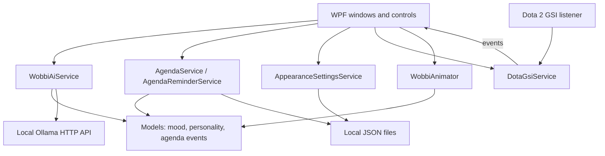

# Wobbi — C#/.NET Developer Case Study 💜

### Building an interactive, locally AI-powered Windows desktop companion

**C# · .NET 10 · WPF / XAML · Ollama · Local JSON persistence · Dota 2 GSI**  
**Project status:** `v0.5.0` — Release Candidate  
**Project type:** Personal software development / portfolio project

> **[← Back to Wobbi's public showcase](../README.md)** · [Watch the demo](https://github.com/user-attachments/assets/451d0fe6-1634-4472-aa87-2f6ba91d56d3) · [Version history](../CHANGELOG.md)

---

## 01 / Project overview

Wobbi started as a simple idea: could a desktop companion feel responsive, expressive, and genuinely useful without depending on a paid online AI service?

I built Wobbi as a **Windows desktop application using C# and WPF**, combining character animations with local language-model conversations. It has since grown into a broader application with configurable behavior, a compact Mini Mode, a weekly agenda, persistent reminders, and an optional Dota 2 GSI integration.

The creative character is the visible part; this case study focuses on the software behind it: **UI events, state transitions, service boundaries, asynchronous HTTP requests, JSON serialization, local persistence, timers, and external integrations**.


### Project at a glance

| | |
| --- | --- |
| **Role** | Personal project — C#/.NET development and interaction design |
| **Platform** | Windows desktop |
| **Framework** | .NET 10 (`net10.0-windows`) |
| **UI** | WPF and XAML |
| **AI** | Ollama + `qwen3:4b-instruct`, accessed over a local HTTP API |
| **Storage** | Local JSON files for preferences and agenda events |
| **Other integration** | Dota 2 Game State Integration (v0.5 release candidate) |

---

## 02 / Technology stack

| Technology | Purpose |
| --- | --- |
| **C# / .NET 10** | Application logic, types, events, timers, and services |
| **WPF / XAML** | Desktop windows, reusable controls, UI interactions, and animations |
| **System.Net.Http / HttpClient** | Asynchronous communication with the local Ollama API |
| **System.Text.Json** | Structured AI responses and local data serialization |
| **SharpVectors.Wpf 1.8.6** | Rendering SVG character artwork |
| **Dota2GSI 2.1.1.8897** | Listening to Dota 2 game-state updates |
| **Windows user32 idle API** | Detecting system inactivity for auto-snooze |

The project enables **nullable reference types** and **implicit usings** in its [project configuration](Wobbi.csproj).

---

## 03 / How the application is organized

The application currently uses a **WPF code-behind approach supported by separate model, service, and animation classes**. It is *not* presented as a full MVVM implementation; the primary window still coordinates a substantial amount of UI behavior.

```text
Wobbi/
├── Animations/
│   └── WobbiAnimator.cs
├── Models/
│   ├── AgendaEvent.cs
│   ├── WobbiAiReply.cs
│   ├── WobbiAppearance.cs
│   ├── WobbiMood.cs
│   └── WobbiPersonality.cs
├── Services/
│   ├── AgendaService.cs
│   ├── AgendaReminderService.cs
│   ├── AppearanceSettingsService.cs
│   ├── DotaGsiService.cs
│   ├── WindowsIdleService.cs
│   └── WobbiAiService.cs
├── Assets/                  # Character art, themes, cursors
├── MainWindow.xaml(.cs)     # Main desktop companion
├── ChatWindow.xaml(.cs)     # AI conversation UI
├── AgendaWindow.xaml(.cs)   # Weekly planner
├── WeekTimelineControl.xaml(.cs)
├── ReminderToastWindow.xaml(.cs)
└── Wobbi.csproj
```

This is a **selective map of the important files**, not a complete file listing.

### Component flow



The diagram is a high-level representation of responsibilities rather than a claim that the UI has no direct dependencies on other components.

---

## 04 / Engineering highlight: Local AI and structured responses

**Source:** [`Services/WobbiAiService.cs`](Services/WobbiAiService.cs)

Wobbi connects to a locally running Ollama instance at `http://127.0.0.1:11434/` using a shared `HttpClient`. It sends an asynchronous request to `api/chat`, without requiring a cloud API key.

Rather than treating the model's answer as an arbitrary string, the request asks for a **structured JSON object** with two fields:

```json
{
  "reply": "A short message to display to the user.",
  "mood": "happy"
}
```

The allowed mood values are `neutral`, `happy`, `excited`, and `curious`.

**How the flow works:**

1. The chat message is combined with recent conversation context and the currently selected personality instructions.
2. `HttpClient.PostAsJsonAsync` sends a non-streaming request to Ollama.
3. The response is checked, parsed with `JsonDocument`, and converted into a `WobbiAiReply` containing text and a `WobbiMood`.
4. The interface displays the answer and can trigger a matching animated reaction.
5. Successful exchanges are retained in memory; the service limits the retained history to **five user/assistant exchanges** plus its system instruction.

**Design decisions and trade-offs:** The structured reply gives the UI a predictable mood value, and personality-specific instructions provide distinct behavior without separate AI models. The conversation context deliberately remains **session-only**. The current implementation validates response properties but is not a full retry or recovery framework for malformed model output or connection failures.

---

## 05 / Engineering highlight: WPF animation and interaction

**Source:** [`Animations/WobbiAnimator.cs`](Animations/WobbiAnimator.cs) · [`MainWindow.xaml.cs`](MainWindow.xaml.cs)

Wobbi uses WPF animation primitives such as `DoubleAnimation`, `TranslateTransform`, `RotateTransform`, and `ScaleTransform`.

- **Mood-based animation:** happy or excited replies create bounce reactions; curious replies trigger a tilt.
- **Personality-aware intensity:** Calm, Balanced, and Playful use different bounce heights and repetition counts.
- **Sleep-aware behavior:** reactions do not interrupt sleep; breathing uses slower timing and a different scale while sleeping.
- **Physical interaction:** pointer capture and hold timers distinguish a quick head pat from a longer scritch; cleanup prevents stuck input states when mouse capture is lost.
- **Mini Mode:** single-click chat activation is delayed briefly to distinguish it from double-click mode switching.

This work required coordinating **input events, visual states, timing, and user preferences** in a responsive desktop UI.


---

## 06 / Engineering highlight: Agenda persistence and reminders

**Sources:** [`Services/AgendaService.cs`](Services/AgendaService.cs) · [`Services/AgendaReminderService.cs`](Services/AgendaReminderService.cs)

Wobbi's agenda is more than a calendar view: it is a small persistence and scheduling feature built around a dedicated event model.

### Agenda data

`AgendaService` manages locally stored events in `%LOCALAPPDATA%\Wobbi\agenda.json`. It validates events and supports **create, read, update, and delete** operations.

An important detail is its failure handling: if saving fails after an add, edit, or delete operation, it **restores the previous in-memory state** rather than pretending the data was successfully persisted. The loading logic also attempts recovery from a backup if the main JSON file is damaged.

### Reminder scheduling

`AgendaReminderService` uses a WPF `DispatcherTimer` with a **30-second checking interval**. It checks for due events, persists the reminder state, and requests a reminder notification through a callback.

The UI also tracks pending notifications for Mini Mode, and the v0.5 design keeps reminder notifications visible until dismissed.

**What this demonstrates:** local serialization, validation, recovery-oriented persistence, event scheduling, state flags, and UI notification coordination.

---

## 07 / Engineering highlight: Dota 2 game-state integration

**Source:** [`Services/DotaGsiService.cs`](Services/DotaGsiService.cs)

The optional Dota companion uses the `Dota2GSI` library and listens for game-state updates through a **local listener on port 34055**. It reacts to information that Dota explicitly exposes through Game State Integration.

The service maintains match-related state, including match IDs, game phases, previous kill/death totals, streak counters, and the last received packet time. From that state it produces events such as `Kill`, `Death`, `KillStreak`, `DeathStreak`, `Victory`, and `Defeat`.

**Notable implementation details:**

- Handles new match IDs by resetting previous-match statistics.
- Compares reported kill/death totals against previous snapshots rather than assuming every GSI update is a new event.
- Uses configurable **5 / 10 / 30-second** reaction cooldowns, with streak milestones treated separately.
- Avoids inventing a winner if valid team/result data is unavailable.
- Reports connection status using the recency of incoming GSI packets.
- Raises events for the WPF interface to handle; cross-thread UI work is dispatched onto the WPF UI thread when needed.

### Safety boundaries

The implementation is deliberately restricted to supported GSI data: **no process-memory reading, injection, modification of the game client, gameplay automation, or hidden information**. Wobbi remains a separate desktop program, not an in-game injected overlay.

> **Current limitation:** v0.5 is a release candidate. Completed-match results, reconnect edge cases, and combined Agenda/Dota regression scenarios still need further live verification. Post-match external-API analysis is planned for a future version, not shipped here.

---

## 08 / Preferences, state, and local data

**Sources:** [`Services/AppearanceSettingsService.cs`](Services/AppearanceSettingsService.cs) · [`Services/WindowsIdleService.cs`](Services/WindowsIdleService.cs)

Wobbi saves selected settings as JSON in `%LOCALAPPDATA%\Wobbi\appearance.json`. This includes appearance, personality, Mini Mode, reduced animation settings, speech bubbles, automatic snoozing, and Dota reaction frequency.

For auto-snooze, `WindowsIdleService` calls the Windows `GetLastInputInfo` API to determine how long the system has been inactive. This integration is intentionally separate from the game-state service: it is ordinary **Windows desktop idle detection**, not access to a game process.

**Trade-off:** Settings are designed for a single local Windows user. This project does not currently provide cloud synchronization or multi-device state management.

---

## 09 / Technical challenges and lessons

| Challenge | Approach used |
| --- | --- |
| Making AI replies drive the character, not just the chat window | Structured JSON output containing reply text and an enumerated mood |
| Avoiding input conflicts between drag, click, double-click, and head-patting | Input-event coordination, short timers, mouse capture, and cancellation logic |
| Keeping reminders reliable across restarts | Persisting event/reminder state and attempting backup recovery for damaged agenda data |
| Preventing noisy or duplicate Dota reactions | Match-state tracking, previous-value comparisons, and configurable cooldowns |
| Maintaining distinct character personalities | Personality-specific prompt instructions and personality-aware animation intensity |
| Making a desktop application feel unobtrusive | Mini Mode, auto-snooze, reduced animations, and non-modal reminder UI |

### What I would improve next

As the project grows, good engineering follow-ups include **extracting more logic from `MainWindow.xaml.cs`**, introducing more easily testable interfaces around services, expanding automated tests, and completing the v0.5 integration checks.

These are development goals, not claims that the current project already has a complete MVVM architecture, an automated test suite, or a production-grade installer.

---

## 10 / Current status and next steps

**Implemented in the current v0.5 codebase:**

- Animated desktop companion with multiple states and appearances.
- Local Ollama chat with structured mood replies.
- Full Mode / Mini Mode, personality and visual preferences.
- Agenda, persisted events, and pending reminder notifications.
- Initial Dota GSI listener, gameplay events, and reaction settings.

**Still in progress:** Dota reconnect and match-result edge cases, final combined regression tests, and packaging/distribution.

**Potential later features:** saved notes and memory, everyday productivity integrations, and post-match statistical reviews using external APIs and local AI.

See [`CHANGELOG.md`](../CHANGELOG.md) for the version history and current limitations.

---

## Run the project

This is currently a source-build Windows application. Install [.NET 10](https://dotnet.microsoft.com/download/dotnet/10.0) and [Ollama](https://ollama.com/download/windows), then run:

```powershell
ollama pull qwen3:4b-instruct

dotnet restore Wobbi/Wobbi.csproj
dotnet run --project Wobbi/Wobbi.csproj
```

Run the `dotnet` commands **from the repository root** (the folder containing `Wobbi.slnx`). You can also open the solution in Visual Studio. Dota GSI requires separate game-side configuration; it is optional for using Wobbi's other features.

---

## About the developer

**Susan Aben**  
C#/.NET and web-development portfolio project

Wobbi brings together my interest in software engineering and creative interaction design. It has been a practical way to develop skills in **C#, WPF, service-oriented code organization, asynchronous APIs, state handling, persistence, and third-party integration** while building something with a distinct personality.

**[← Explore Wobbi's visual showcase](../README.md)**

*Small blob. Real engineering. Big personality.* 💜